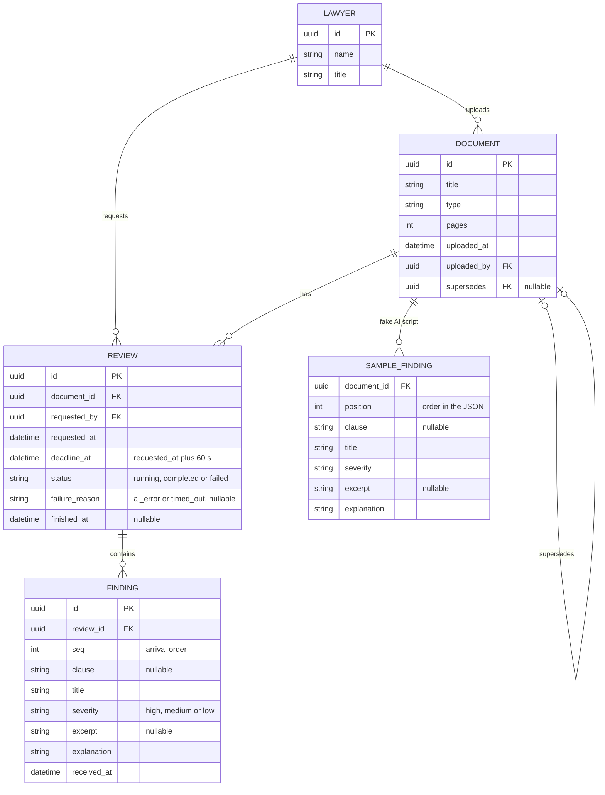
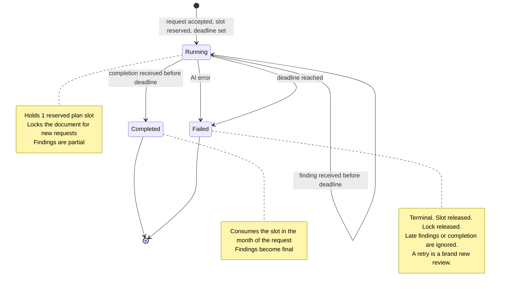
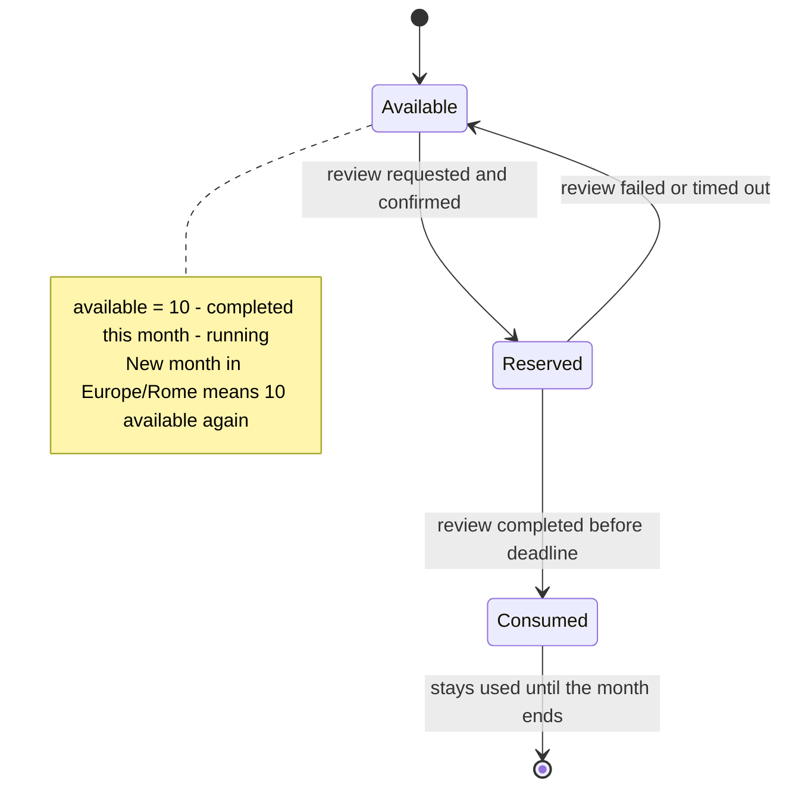
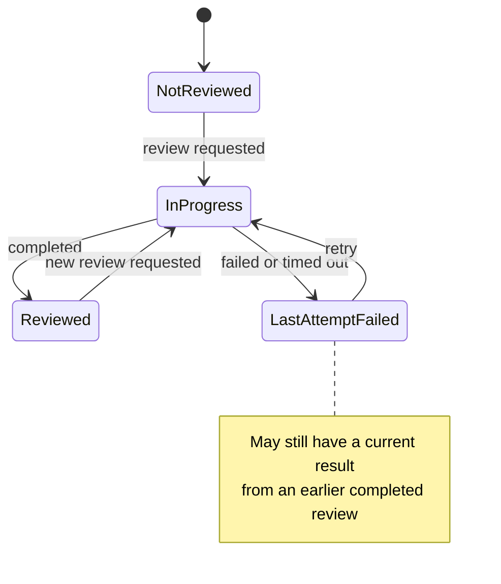

# Domain model and business rules

[← Back to the index](README.md)

Data model, state machines, and the normative business rules (BR-x).

## Domain model and state machines

### Entity-relationship model

Key constraints:

- `UNIQUE (document_id) WHERE status = 'running'` enforces R2 at the DB level.
- `UNIQUE (review_id, seq)` makes finding inserts idempotent.
- `CHECK (status IN ('running','completed','failed'))`, and `failure_reason` is not null iff status = failed.
- Index `(status, requested_at)` for the quota count. The plan month of a review is derived from `requested_at` converted to Europe/Rome.

### Review state machine (the core of the rules)

### Plan slot lifecycle

### Document display state (what the list shows)

---

## Business rules catalogue (normative)

| ID | Rule |
|---|---|
| BR-1 | The workspace plan allows **10 completed reviews per calendar month** (Europe/Rome). |
| BR-2 | `available = PLAN_LIMIT − count(completed with requested_at in the current Europe/Rome month) − count(running with deadline_at > now and requested_at in the current Europe/Rome month)`. |
| BR-3 | A request is accepted only if `available ≥ 1` **and** the document has no running review. Both are checked **in the same serialized transaction** as the insert. |
| BR-4 | A review belongs to the Europe/Rome calendar month of its request (`requested_at`): it reserves a slot there, and if it completes, it consumes that slot there. |
| BR-5 | Failed reviews (any reason) never count against the plan. |
| BR-6 | At most one `running` review per document, whoever requested it (enforced by a unique partial index). |
| BR-7 | `deadline_at = requested_at + 60 s`. A review is `running` only while `now < deadline_at`. |
| BR-8 | At `now ≥ deadline_at`, a running review **is** `failed/timed_out`, whether or not it has been persisted yet. Every read and every request transaction applies this. |
| BR-9 | Findings and completion from the AI are accepted only through a conditional write (`status = running AND now < deadline_at`). Otherwise they are discarded and logged. |
| BR-10 | Completed and failed are **terminal**. No transition leaves them. |
| BR-11 | A retry creates a new review and goes through BR-3 again (and the confirmation). |
| BR-12 | No request is accepted when `available = 0`. There is **no queue** and no deferred execution. |
| BR-13 | Every request requires an explicit confirmation that shows its cost and the remaining plan. |
| BR-14 | Every mutating API call must carry a valid lawyer id. The review stores `requested_by`. |
| BR-15 | Findings of a running review are shown marked **"Partial"**: no totals, a draft style, an incomplete banner. |
| BR-16 | A failed review is displayed only as a status (reason, time, requester, not counted, Retry). Its findings are stored but **never displayed**. |
| BR-17 | Final findings are ordered by severity (high → medium → low), then natural clause order (null clause last). Partial findings are in arrival order. |
| BR-18 | While a review runs, the most recent **completed** review of the document (if any, skipping failed ones) stays visible, labelled **"Previous result · no longer current"**, never merged. |
| BR-19 | Latest review = most recent `requested_at`, whatever its status (shown in the list). Current result = most recent `completed` (the only kind of review whose findings are displayed). |
| BR-21 | Completed reviews are viewable for every document, including superseded ones. A superseded document is labelled "Previous version". |
| BR-22 | Two distinct "replacement" concepts, never mixed: a **document** is *superseded* by a newer document version (from the data, `supersedes`). A **review** is *replaced as current* by a newer completed review **of the same document**. A review of one version never replaces the review of another version. |
| BR-20 | All lawyers have identical permissions. |
