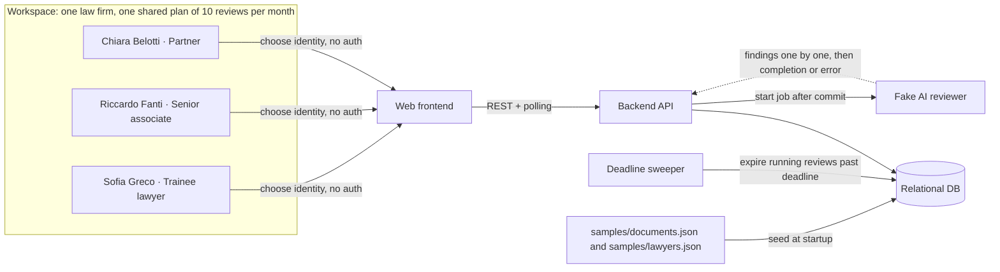
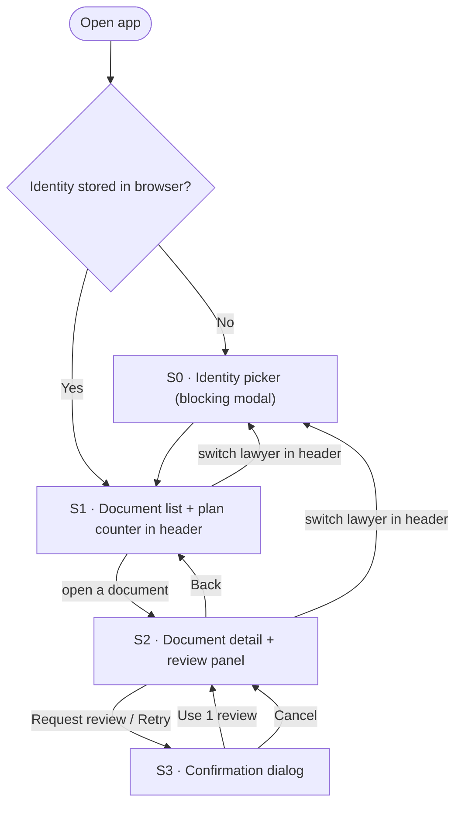
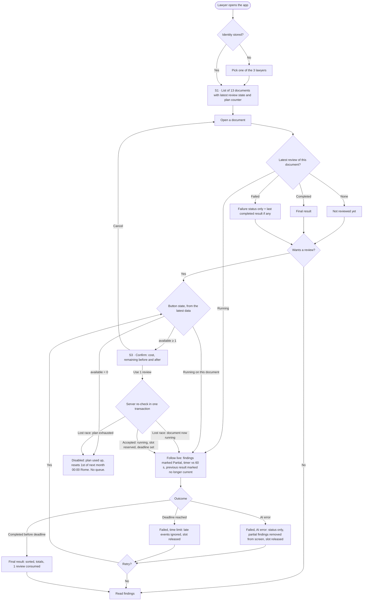
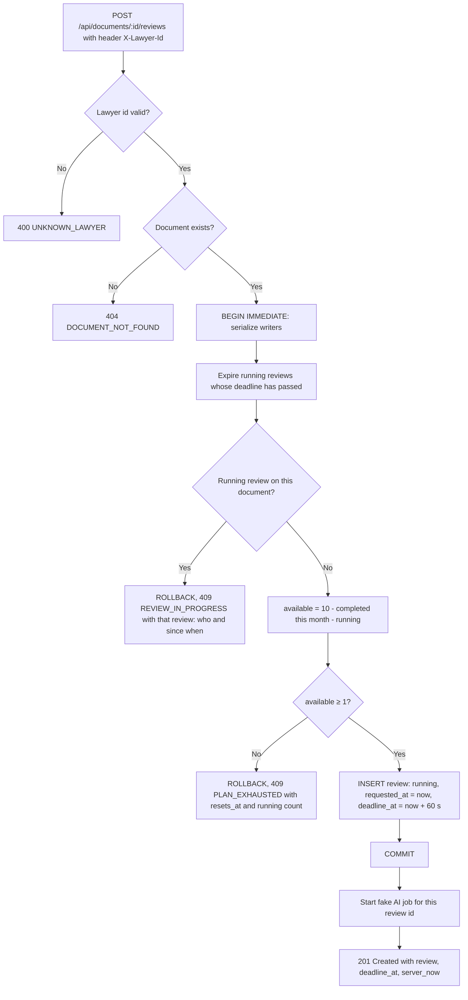
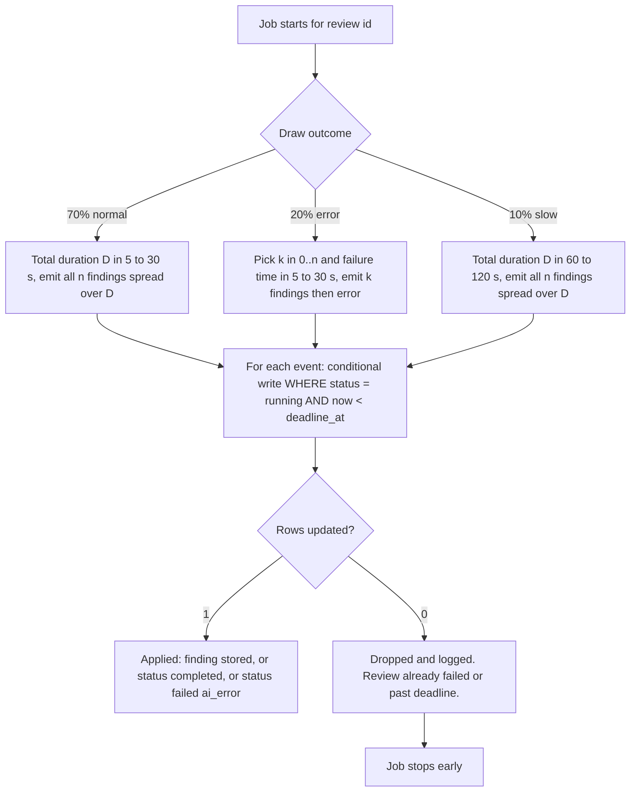
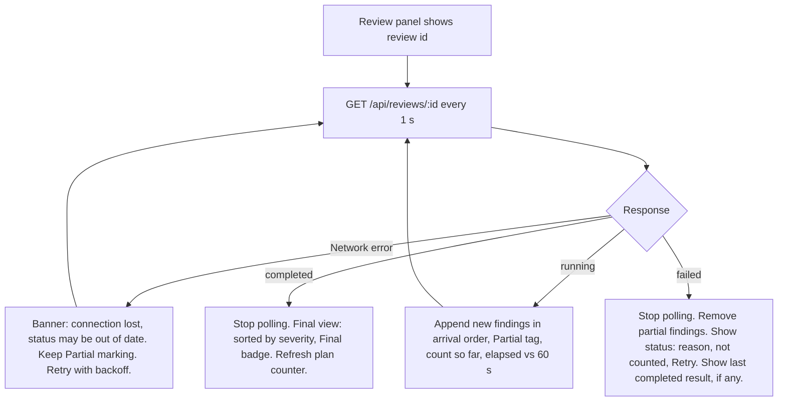
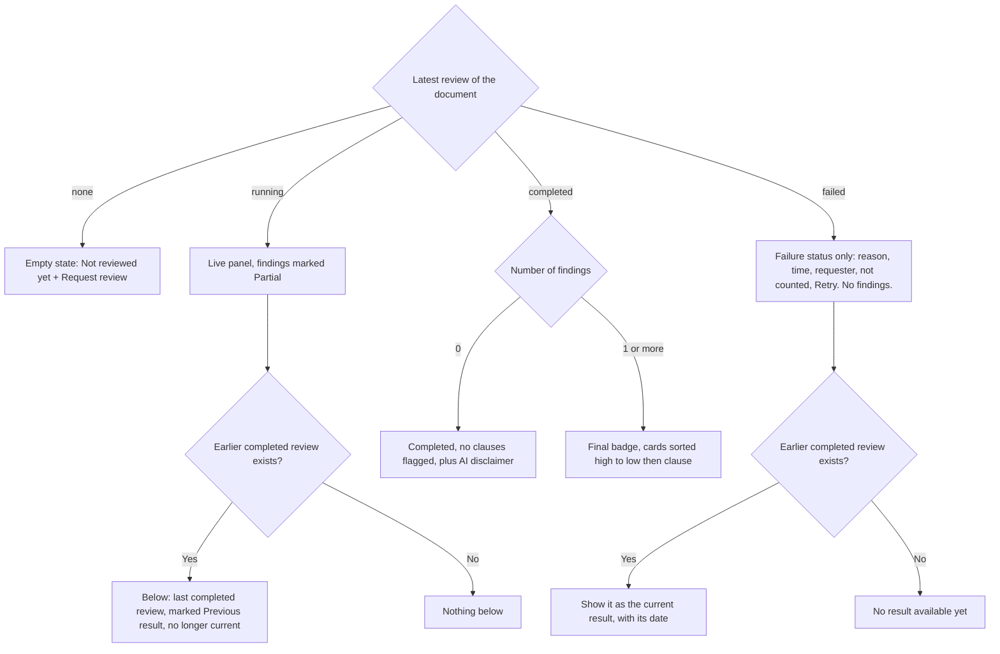
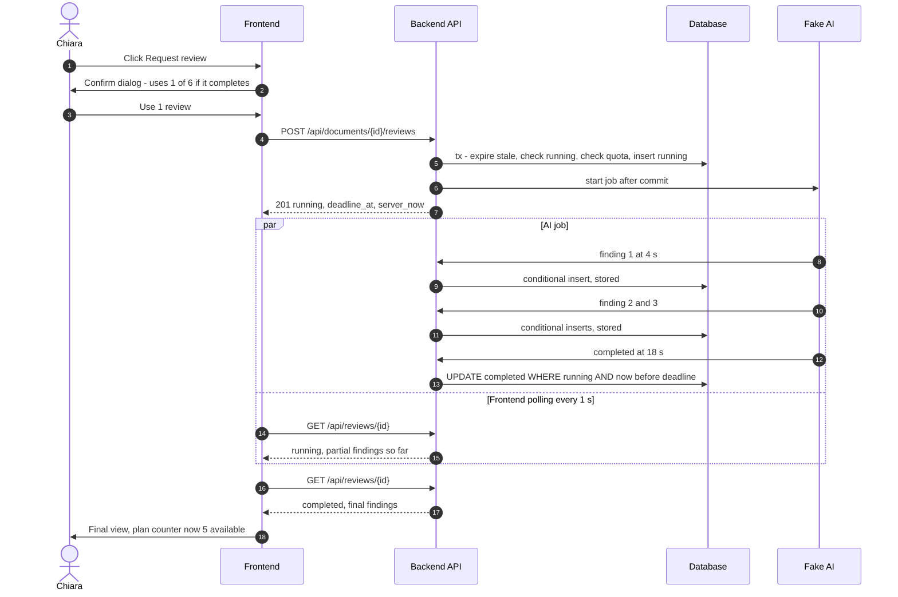
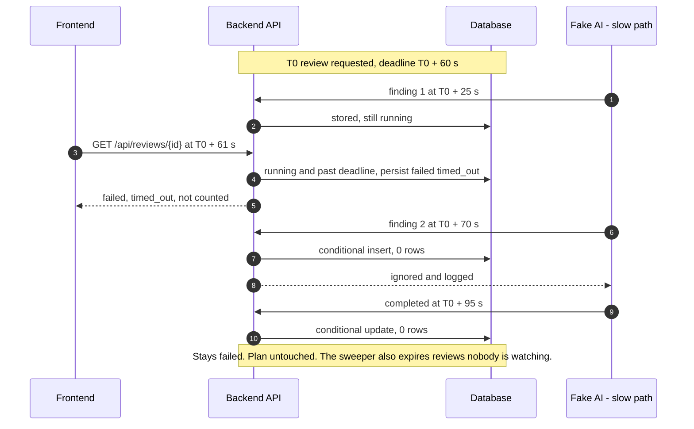
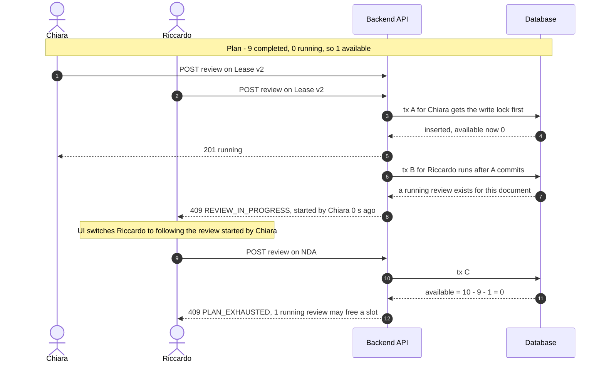

# User flows and sequence diagrams

[← Back to the index](README.md)

How the application works end to end: actors, screen map, user flows, server logic and sequence diagrams.

## Actors and system context

## Screen map

## End-to-end user flow (all three flows, with decision points)

## Request a review: server-side decision flow

## Fake AI job and event handling

## Following a review live (client)

## What the review panel shows (reading flow)

## Sequence diagrams

**a) Happy path with streaming**

**b) Slow run: timeout, then late events**

**c) Races: same document, then the last slot**

