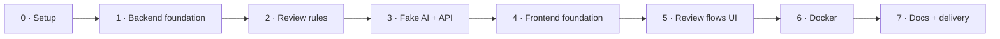

# Implementation plan

[← Back to the index](README.md)

Actionable working document. Work through the phases **in order**. Each phase ends with a **checkpoint**: every exit criterion must be met (✅) before starting the next phase. If a criterion can't be met, record why in the phase notes and decide explicitly: fix now, or record it as a limitation in the README.

**How to use the checklists:** tick `[x]` as items are done. Don't tick a checkpoint item until it has been verified with the command or check given.

---

## Overview

| Phase | Goal |
|---|---|
| 0 | Repository and tooling ready |
| 1 | Backend foundation: models, seed, read endpoints |
| 2 | Review rules in the service layer, fully tested |
| 3 | Fake AI, sweeper and review endpoints |
| 4 | Frontend foundation: proxy, identity, document list, plan counter |
| 5 | Frontend review flows: request, follow, read |
| 6 | Docker: one-command run and test |
| 7 | Documentation and delivery |

---

## Phase 0 · Repository and tooling

**Goal:** an empty but runnable skeleton, with versions resolved.
**References:** [TD-11](12-technical-decisions.md#td-11--versions-and-tooling), [TD-13](12-technical-decisions.md#td-13--code-organization).

- [x] Look up the latest stable versions of Python, Django, Django Ninja, Node.js, Next.js, pnpm and uv on the official registries. Write them in the phase notes.
- [x] Create `api/` (backend) with `uv` (Django, Django Ninja, pytest, pytest-django, a WSGI server) and pin them in `uv.lock`.
- [x] Create `web/` (frontend) with the Next.js App Router + TypeScript template using `pnpm`, pinned in `pnpm-lock.yaml`.
- [x] Root `README.md` skeleton with the required headings: run, tests, decisions on the three points, assumptions, limitations, time spent, AI tools used.
- [x] Decide where the AI session log goes (e.g. `ai-log/`) and start saving it.
- [x] Commit.

### ✅ Checkpoint 0

| Exit criterion | Verify by |
|---|---|
| ✅ Backend starts | `uv run python manage.py check` reports no issues |
| ✅ Frontend starts | `pnpm dev` serves the default page |
| ✅ Versions recorded and pinned | Phase notes list the versions; lockfiles committed |
| ✅ README skeleton present | All required headings exist |

**Notes:**

- Versions (latest stable, pinned):

  | Tool | Version |
  |---|---|
  | Python | 3.15.2 |
  | uv | 0.13.7 |
  | Django | 6.1.3 |
  | Django Ninja | 1.7.3 |
  | dj-database-url | 3.1.2 |
  | gunicorn (WSGI server) | 26.2.0 |
  | pytest / pytest-django | 9.2.0 / 4.14.0 |
  | Node.js | 26.13.0 (LTS) |
  | pnpm | 12.18.0 |
  | Next.js | 16.4.5 |
  | React | 19.3.1 |
  | TypeScript | 7.0.2 |
  | Vitest | 5.1.0 |

- Folders are `api/` (backend) and `web/` (frontend); the Docker services use the same names.
- The README documents two ways to run and test: Docker, and locally without Docker (uv, Node.js, pnpm). The commands that don't exist yet (`seed`, Docker files) arrive in phases 1 and 6; checkpoint 7 checks them from a fresh clone.
- The local backend runs with gunicorn (one worker, several threads), like in Docker, so there is exactly one sweeper (TD-4).
- Scaffolds trimmed to what the plan needs:
  - `api/`: no ASGI entry point (WSGI only), no admin, auth, sessions, messages, static files or templates (no authentication in the brief).
  - `web/`: no Tailwind (plain CSS), no ESLint (`next build` still type-checks), no demo assets or fonts, and no Cache Components or partial prefetching. `next.config.ts` sets `agentRules: false`, because `next dev` otherwise writes an `AGENTS.md` whenever it detects an AI coding agent.
- AI session log: `ai-log/`, exported in phase 7.

---

## Phase 1 · Backend foundation

**Goal:** the data model exists with its constraints, the sample data is seeded, and read-only endpoints return it.
**References:** [Domain model](04-domain-model-and-business-rules.md), [API contract](08-api-contract.md), [TD-2](12-technical-decisions.md#td-2--database-sqlite-switchable-to-postgresql), [TD-3](12-technical-decisions.md#td-3--concurrency), [TD-5](12-technical-decisions.md#td-5--time-and-randomness), [TD-10](12-technical-decisions.md#td-10--startup-migrations-and-seeding).

- [x] Settings from environment: `DATABASE_URL` (default SQLite), `PLAN_LIMIT=10`, `REVIEW_TIMEOUT_S=60`, `PLAN_TZ=Europe/Rome`, `USE_TZ=True`.
- [x] SQLite options: `transaction_mode = IMMEDIATE`, WAL mode, busy timeout.
- [x] `workspace` app: `Lawyer`, `Document` (with self-reference `supersedes`), `SampleFinding` (the fake AI's script, with `position`).
- [x] `reviews` app: `Review` (`status`, `failure_reason`, `requested_by`, `requested_at`, `deadline_at`, `finished_at`) and `Finding` (`seq`, nullable `clause` and `excerpt`).
- [x] Constraints: one running review per document (conditional unique), `(review, seq)` unique, status and failure-reason checks.
- [x] `Clock` interface with a system and a fake implementation.
- [x] Idempotent `seed` command reading `samples/lawyers.json` and `samples/documents.json`.
- [x] Endpoints: `GET /api/lawyers`, `GET /api/documents`, `GET /api/documents/{id}`, `GET /api/plan` (plan computed from BR-2, even if no review exists yet).
- [x] Tests: seed loads 3 lawyers, 13 documents and the right number of sample findings; running it twice changes nothing; the conditional unique constraint rejects a second running review on the same document.
- [x] Commit.

### ✅ Checkpoint 1

| Exit criterion | Verify by |
|---|---|
| ✅ Migrations apply from scratch | Delete the SQLite file, run `migrate` |
| ✅ Seed is complete and idempotent | Tests green; run `seed` twice and counts stay 3 / 13 |
| ✅ Superseded lease is linked | `GET /api/documents` shows `supersedes` / `superseded_by` on the two leases |
| ✅ Null clause and excerpt survive | The 3 "missing clause" findings have `null` clause and excerpt |
| ✅ Plan endpoint answers | `GET /api/plan` returns `available = 10`, `resets_at` = 1st of next month 00:00 Europe/Rome |
| ✅ All tests green | `uv run pytest` |

**Notes:**

- The samples hold **47** sample findings (the franchise agreement alone has 18).
- `GET /api/plan` needs BR-2, so `reviews/services/plan.py` (`plan_month`, `get_plan`) is written here. Its Europe/Rome month boundaries are tested now (UTC vs Rome at midnight, new year, daylight saving). The counting scenarios with reviews stay in phase 2.
- Errors already use the contract body `{code, message, details}`: `404 NOT_FOUND` and `422 INVALID_REQUEST` (malformed id), from one helper in `config/api.py` that phase 3 reuses.
- `GET /api/documents` lists newest upload first (the wireframe does not fix an order). `latest_review` and `current_result` are added in phase 3, as planned.
- The application clock is `reviews.clock.clock`. Services take `now` as an argument; tests swap the clock with the `fake_clock` fixture.
- The seed folder is configurable with `SAMPLES_DIR` (default `../samples`), for the Docker image in phase 6. The seed never touches reviews.
- Ninja's interactive docs page is off: it needs the template and static-file apps removed in phase 0.
- A test caught a real bug: the "failure reason only when failed" check accepted a failed review with no reason, because in SQL `NULL IN (...)` is unknown and a `CHECK` lets unknown pass. Fixed with an explicit `IS NOT NULL`.
- Phase 6 watch-out: slim Python images may lack system time zone data; add the `tzdata` package if `Europe/Rome` fails to load there.

---

## Phase 2 · Review rules (service layer)

**Goal:** every business rule about the plan, concurrency and the deadline is implemented in `reviews/services/` and proven by tests, with no HTTP and no real time involved.
**References:** [Business rules BR-1 to BR-14](04-domain-model-and-business-rules.md#business-rules-catalogue-normative), [Acceptance criteria](09-acceptance-criteria.md) (features *Plan*, *One review in progress per document*, *Deadline*).

- [x] `plan` service: `available`, `completed`, `running` and `resets_at` for the current Europe/Rome month, by `requested_at` (BR-1, BR-2, BR-4, BR-5).
- [x] `expire` service: mark running reviews past their deadline as `failed/timed_out` (BR-8). Used by reads, by the request transaction and by the sweeper.
- [x] `request_review` service in **one transaction**: expire stale reviews → reject if one is running on the document (`ReviewInProgress`) → reject if `available < 1` (`PlanExhausted`, with `completed`, `running`, `resets_at`) → insert with `deadline_at = requested_at + 60 s` (BR-3, BR-6, BR-7, BR-12).
- [x] Lifecycle services with **conditional writes** (`status = running AND now < deadline_at`): `add_finding`, `complete`, `fail_ai_error`. Each returns whether it was applied; a late event is dropped and logged (BR-9, BR-10).
- [x] Read services: latest review and current result of a document (BR-19), previous completed review skipping failed ones (BR-18).
- [x] Tests (fake clock), one per acceptance scenario:
  - [x] Successful review consumes one slot
  - [x] Failed review does not consume
  - [x] Running reviews reserve slots
  - [x] Reservation released on failure
  - [x] Strict block when the plan is used up
  - [x] Month boundary counts in the month of the request
  - [x] A review running at midnight does not reserve a slot in the new month
  - [x] Stale running row does not block
  - [x] Late completion is ignored (no late finding stored, plan unchanged)
  - [x] Boundary at exactly 60 s → failed
  - [x] Completion at 59.999 s → completed
  - [x] Retry is a new review
  - [x] Previous review skips failed reviews
- [x] Concurrency test: two simultaneous requests on the same document → exactly one review created; two simultaneous requests for the last slot → exactly one accepted.
- [x] Commit.

### ✅ Checkpoint 2

| Exit criterion | Verify by |
|---|---|
| ✅ Every scenario above has a passing test | `uv run pytest reviews` |
| ✅ No business rule outside `services/` | Review: `api.py` and models contain no plan or deadline logic |
| ✅ No direct call to the system time in services | Search for `timezone.now` / `datetime.now` outside `clock.py` |
| ✅ Late events never change a terminal review | Dedicated tests pass |
| ✅ Concurrency holds | Concurrency tests pass several runs in a row |

**Notes:**

- Services: `expiry.py`, `request.py`, `lifecycle.py`, `reads.py`, next to `plan.py`. Every service takes `now` as an argument; none reads the time itself.
- BR-18 and BR-19 need a single read: the "previous result" shown during a run **is** the current result (the latest completed review). `current_result` serves both; there is no separate "previous" function.
- An expired review gets `finished_at = deadline_at` (when it actually timed out), not the time the expiry happened to run.
- `add_finding` stores a copy of a `SampleFinding`, so the fake AI in phase 3 only passes the sample and its arrival number.
- Tests beyond the scenario list, each guarding a rule a future change could break: every terminal state (completed, AI error, timed out) rejects all three late events; failed reviews of either reason and reviews of earlier months never count; "review in progress" is reported before "plan exhausted"; a stale row holds no slot; reviews of one lease version never replace the other's (BR-22); reads report an overdue review as timed out.
- Concurrency: 5 threads at once, 5 runs per test, on a **file** SQLite test database (the in-memory one does not lock like the real database). Checked that the tests catch a race: with both the `IMMEDIATE` mode and the expiry `UPDATE` removed, all 10 runs fail.
- Finding: the request transaction is serialized even without `IMMEDIATE`, because its first statement (the expiry `UPDATE`) already takes SQLite's write lock. `IMMEDIATE` stays, so correctness does not depend on statement order.
- Boundaries checked by deliberately breaking the code: `<` vs `<=` on the deadline, in the lifecycle writes and in the expiry, each makes a test fail.

---

## Phase 3 · Fake AI, sweeper and review endpoints

**Goal:** a review can be requested over HTTP, runs in the background, and can be followed until it completes or fails.
**References:** [TD-4](12-technical-decisions.md#td-4--background-work-threads-in-the-backend-process), [Fake AI flow](05-user-flows.md#fake-ai-job-and-event-handling), [API contract](08-api-contract.md), Q7 in [Questions and decisions](10-scope-and-questions.md#questions-and-decisions).

- [x] Fake AI: one draw per run, **error ~20% / slow ~10% / completed ~70%** (mutually exclusive). Normal: all findings spread over 5–30 s. Error: `k ∈ [0, n]` findings, then error within 5–30 s. Slow: all findings spread over 60–120 s. Clock, RNG and sleep injected.
- [x] The fake stops as soon as a write is not applied (review already terminal).
- [x] Start the fake AI thread **after commit** (`transaction.on_commit`).
- [x] Sweeper thread started once at backend startup.
- [x] `POST /api/documents/{id}/reviews` with `X-Lawyer-Id`: `201`, `400 UNKNOWN_LAWYER`, `404`, `409 REVIEW_IN_PROGRESS {review}`, `409 PLAN_EXHAUSTED {resets_at, completed, running}`. Error body `{code, message, details}`.
- [x] `GET /api/reviews/{id}`: applies lazy expiry; returns `server_now`, `deadline_at`, `is_final`; `findings` for running and completed, **always `[]` for failed** (BR-16).
- [x] `GET /api/documents` returns `latest_review` and `current_result`.
- [x] Tests: fake AI outcomes with a seeded RNG (all three outcomes, error after 0 and after k findings, 0-finding document completes); API status codes and error bodies; failed review returns no findings.
- [x] Manual run: request a review locally and poll it until it ends.
- [x] Commit.

### ✅ Checkpoint 3

| Exit criterion | Verify by |
|---|---|
| ✅ A full review runs end to end | Manual `curl` POST then GET until terminal |
| ✅ All three outcomes reachable | Fake AI tests with fixed seeds |
| ✅ A slow run always ends as `timed_out` and never consumes | Test with a slow outcome and the fake clock |
| ✅ API errors match the contract | API tests for every status code |
| ✅ Failed reviews expose no findings | API test |
| ✅ All backend tests green | `uv run pytest` |

**Notes:**

- The fake AI is split in two: `write_script` (pure: draws the outcome and the event times from the RNG) and `run` (plays a script against the database with an injected clock and sleep). Script tests check the brief's rates and time ranges over 10,000 seeded draws; run tests play hand-written scripts on the fake clock.
- Event times count from `requested_at`, the same origin as the deadline.
- `on_commit` is registered inside the request transaction, so the AI thread never sees an uncommitted review. An autouse test fixture replaces `fake_ai.start` with a recorder: no test starts a real thread, and one API test checks the start happens after commit.
- The sweeper starts in `config/wsgi.py`, not in an `AppConfig`, so `migrate`, `seed` and the tests never start it. It runs every 5 s.
- `GET /api/documents` and `/api/documents/{id}` moved from `workspace` to `reviews`: they now carry review state, and `workspace` stays independent of `reviews`.
- Reads expire overdue reviews **once per request** (`list_documents`, `get_document`, `get_review`), then read. `latest_review` and `current_result` are plain queries. The list runs 2 small queries per document (13 documents); fine at this size.
- `latest_review` has the summary fields plus `deadline_at` (needed for a countdown in the list). It has no `findings_count`: when the latest review is completed it is also `current_result`, which has the count.
- Errors: one `ApiError` exception, rendered by one handler, so every error has the `{code, message, details}` body. Lawyer is checked before the document (`400` before `404`); a missing, empty or malformed `X-Lawyer-Id` is also `UNKNOWN_LAWYER`.
- Added a minimal `LOGGING` config: without it Django drops the `INFO` logs of the `reviews` app (fake AI outcome, dropped late events, sweeper).
- Manual run (8 reviews, real threads, real time): 5 completed, 2 AI errors, 1 slow run that timed out at 60 s with its 11 partial findings hidden; the plan ended at 5 completed, 5 available.

---

## Phase 4 · Frontend foundation

**Goal:** the frontend talks to the API through the proxy, a lawyer can pick an identity, and the document list shows each document's latest review state and the plan.
**References:** [TD-6](12-technical-decisions.md#td-6--real-time-updates-polling), [TD-7](12-technical-decisions.md#td-7--identity), [TD-9](12-technical-decisions.md#td-9--frontend--api-same-origin-proxy), [Wireframes S0 and S1](06-screens-and-ui-states.md#wireframes-low-fidelity), [UI state matrices](06-screens-and-ui-states.md#ui-state-matrices).

- [x] Proxy `/api/*` to the backend. Choose build-time `rewrites` or a runtime route handler (TD-9), and note the choice.
- [x] Typed API client and a polling hook (intervals from TD-6; stop on terminal status).
- [x] Identity picker: blocking on first visit, stored in `localStorage`, switchable from the header; `X-Lawyer-Id` sent on mutations.
- [x] Header plan counter: `{available} of 10 available · {running} running · resets {date}` (Europe/Rome), red at 0.
- [x] Document list: title, upload date and uploader, **"Previous version · superseded by the version of {date}"** label, latest review badge for every state in the matrix (not reviewed, in progress, completed with n findings, completed with no clauses flagged, failed with or without an earlier result).
- [x] Pure display logic in `lib/` (badge state) with unit tests.
- [x] Commit.

### ✅ Checkpoint 4

| Exit criterion | Verify by |
|---|---|
| ✅ Browser only calls the frontend origin | Browser network tab: no direct call to the backend port |
| ✅ Identity persists and can be switched | Reload the page; switch lawyer from the header |
| ✅ List shows the 13 documents and the superseded label | Visual check against wireframe S1 |
| ✅ Every badge state renders | Unit tests on badge logic, plus a manual check with seeded reviews |
| ✅ Plan counter is live | Request a review with `curl`; the counter updates within the polling interval |

**Notes:**

- Proxy: a runtime route handler (`src/app/api/[...path]/route.ts`), not `rewrites`. It reads `API_URL` at request time, so one build works locally and in Docker. It forwards only `X-Lawyer-Id`, and returns `502 API_UNAVAILABLE` (same error body) when the backend cannot be reached.
- `usePolling(load, nextDelay)`: `nextDelay` picks the next interval from the data (TD-6) or returns `null` to stop. On error it keeps the last data and retries after 2 s.
- The list and the header poll every 2 s while a review is running, otherwise every 10 s. The elapsed time in the list uses the browser clock (display only; the deadline is never decided on the client).
- Dates use fixed English month names and the Europe/Rome time zone, so they do not depend on the browser locale (`Intl` en-GB writes "Sept").
- Document titles link to `/documents/{id}`; the page is built in Phase 5.
- Manual check in a production build (`next build` + `next start`). In `next dev`, open the app on `localhost`: the dev server blocks its scripts for other hosts such as `127.0.0.1` (Next.js `allowedDevOrigins`).

---

## Phase 5 · Frontend review flows

**Goal:** the three flows of the brief work in the browser, and the three decisions are visible in what is built.
**References:** [Decisions](03-decisions.md), [Screens and UI states](06-screens-and-ui-states.md), [Errors and edge cases](07-errors-and-edge-cases.md), BR-11 to BR-21.

- [x] Document detail page with the review panel.
- [x] Request button states, in priority order: running on this document · `available = 0` with reviews in progress (**explicit message**: completed + in progress = 10, a failing review frees its slot within 60 s, request not saved) · plan used up (reset date) · request in flight · "Retry review" · "Request a new review" · "Request review".
- [x] Confirmation dialog: cost, available before → after, free if it fails or exceeds 60 s, "last review this month" wording when 1 is left (BR-13).
- [x] `409 REVIEW_IN_PROGRESS` → switch to following the existing review, showing who started it. `409 PLAN_EXHAUSTED` → "Your request has not been saved" + the matching explanation.
- [x] Live panel: findings in arrival order, **"Partial"** tag and draft style, incomplete banner, no totals, elapsed time against 60 s from `server_now` (BR-15).
- [x] Previous **completed** review below the live one, labelled **"Previous result · no longer current"**, each finding tagged "Previous", never merged (BR-18).
- [x] Completion: "Partial" tags removed, sorted by severity then natural clause order, "General" last, **Final** badge (BR-17).
- [x] Failure: status only (reason, time, requester, not counted, Retry), **no findings**, then the last completed review as the current result if there is one (BR-16).
- [x] Special cases: "Completed · no clauses flagged" with disclaimer (Consulting agreement); "General (no specific clause)" and the missing-excerpt note; severity shown with text and icon, not colour only.
- [x] Connection-lost banner ("Should").
- [x] Unit tests on the pure logic: button state, finding sort order, label selection.
- [x] Commit.

### ✅ Checkpoint 5

Walk through every scenario of the *Reading results* and *Identity* features in [acceptance criteria](09-acceptance-criteria.md) in the browser, plus:

| Exit criterion | Verify by |
|---|---|
| ✅ Flow 1: list shows each document's latest review state | Manual check, two browser windows with different lawyers |
| ✅ Flow 2: a review can be requested and followed until it completes or fails | Request reviews until all three outcomes have been seen (or use a seeded fake) |
| ✅ Flow 3: a completed review is readable, sorted, with severity and explanation | Franchise agreement (16 findings) and NDA (null clause) |
| ✅ Decision 1 visible | Previous result labelled "no longer current" while a new review runs |
| ✅ Decision 2 visible | Partial tags while running; nothing shown from a failed review |
| ✅ Decision 3 visible | Plan used up → button disabled with the reset date; no request is saved |
| ✅ Two lawyers, same document | Second lawyer is switched to following the first lawyer's review |
| ✅ Frontend unit tests green | `pnpm test` |

**Notes:**

- The plan is polled once, in a `PlanProvider` shared by the header counter and the request button, and reloaded right after a request. While a review runs it is polled every 2 s, so a held slot that frees up re-enables the button on its own.
- The detail page polls one loader (document, latest review, current result): 1 s while its review runs, 2 s while any review runs, 10 s otherwise. A review started by another lawyer is picked up within that interval (edge case 20).
- What the panel shows is one pure function, `panelSections(latest, result)`, tested for every row of the panel matrix. A failed review's section renders a status only, and the API already returns no findings for it (BR-16).
- The request button and its explanation sit above the panel in every state (one place for "Request review", "Retry review" and "Request a new review"), rather than inside each panel box as in the low-fidelity wireframes.
- Elapsed time uses `server_now` from the last poll (edge case 21), so it advances with the 1 s polling, not with a client timer.
- The Franchise agreement has 18 findings in `samples/documents.json` (the table above says 16).
- Manual walkthrough (production build, real fake AI): failed with an earlier result (NDA, no findings of the failed attempt shown); failed with no result (Loan); live run with Partial findings and the previous result below it; one run ended with an AI error after a partial finding, which disappeared; completion re-sorted with the Final badge; Consulting "no clauses flagged"; Franchise sorted by severity then clause order; 409 `REVIEW_IN_PROGRESS` switched to following the other lawyer's review; 9 completed + 1 running showed the "in use" message, then the "plan used up" message once it completed; unknown document id; backend stopped, then the connection-lost banner, and recovery. The `PLAN_EXHAUSTED` notice is covered by unit tests only.

---

## Phase 6 · Docker

**Goal:** the evaluator can run and test everything with Docker only.
**References:** [TD-8](12-technical-decisions.md#td-8--containerization-docker-compose-two-services), [TD-10](12-technical-decisions.md#td-10--startup-migrations-and-seeding).

- [x] `api/Dockerfile`: install with `uv`, entrypoint runs `migrate`, `seed`, then the WSGI server with **one worker and several threads**.
- [x] `web/Dockerfile`: multi-stage build, production server.
- [x] `docker-compose.yml`: `api` and `web` services, named volume for SQLite, only the frontend port published, backend URL passed to the frontend (build argument or environment, per the phase 4 choice).
- [x] `samples/` mounted or copied into the backend image for seeding.
- [x] Commit.

### ✅ Checkpoint 6

| Exit criterion | Verify by |
|---|---|
| ✅ Works from a fresh clone | Clone into a new folder, `docker compose up --build`, open the app, complete one review |
| ✅ Restart keeps data, no duplicates | `docker compose restart`; reviews still there, still 13 documents |
| ✅ Backend tests run in Docker | `docker compose run --rm api pytest` green |
| ✅ Only the frontend is exposed | `docker compose ps`: only the frontend port is published |

**Notes:**

- Base images pinned to the versions used locally: `python:3.15.2-slim`, `ghcr.io/astral-sh/uv:0.13.7`, `node:26.13.0-slim`. The slim Python image ships the time zone database, so `Europe/Rome` needs no extra package.
- Backend: dependencies installed from `uv.lock` (dev group kept, so `pytest` runs in the same image); `samples/` copied in from a second build context (`additional_contexts`), so the build context stays `api/`. SQLite lives in the `db` named volume (`DATABASE_URL=sqlite:////data/db.sqlite3`). Runs as a non-root user.
- Frontend: Next.js `output: "standalone"`; the runtime stage holds only the server and its traced dependencies, run as the `node` user. `API_URL=http://api:8000` is an environment variable, read at request time by the phase 4 route handler.
- `web` waits for the `api` healthcheck, so the first page load never hits a backend that is still migrating and seeding.
- Frontend tests in Docker: the runtime image has no dev dependencies, so a `web-test` service (profile `test`, build stage of the same Dockerfile) runs them: `docker compose run --rm web-test`.
- Gunicorn 26 opens a control socket in the user's home directory, so the backend user is created with one.

---

## Phase 7 · Documentation and delivery

**Goal:** the repository contains everything the brief asks to deliver.
**References:** the brief's "What to deliver" and "Evaluation points".

- [ ] README: run instructions (Docker and local), test instructions.
- [ ] README: decisions on the three points with their reasons, and what was refused (link to [decisions](03-decisions.md)).
- [ ] README: assumptions (Europe/Rome, month of the request, completed vs failed reviews, identity, Q6 still open).
- [ ] README: limitations (SQLite only and how to switch, in-process threads, no authentication, anything unfinished from the checkpoints).
- [ ] README: time actually spent, deduced from the timestamps of the AI session log (first to last message, analysis included).
- [ ] README: AI tools used and how.
- [ ] AI session log exported, with anything personal or confidential removed.
- [ ] Final pass over the [acceptance criteria](09-acceptance-criteria.md): every scenario covered by a test or a recorded manual check.
- [ ] Final commit.

### ✅ Checkpoint 7 (delivery)

| Exit criterion | Verify by |
|---|---|
| Every deliverable of the brief is present | Tick against the brief's "What to deliver" list |
| README instructions work as written | Follow them from a fresh clone |
| Nothing confidential in the AI log | Read it through once |
| Time spent is stated | Matches the timestamps of the AI session log |

**Notes:**

---

## If time runs short

Cut in this order, and record each cut as a limitation in the README:

1. Connection-lost banner.
2. Frontend unit tests beyond button state and sort order.
3. Docker for the frontend (keep the backend in Docker, document `pnpm dev` for the frontend).

Never cut: the backend rule tests (phase 2), the three decisions being visible in the UI, and the README sections required by the brief.
